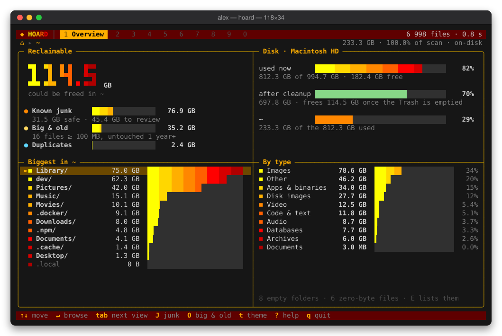
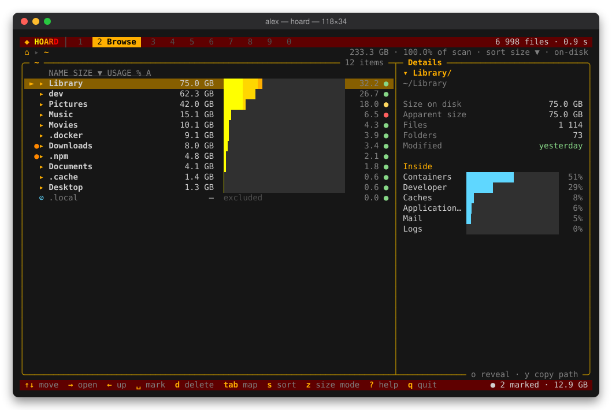
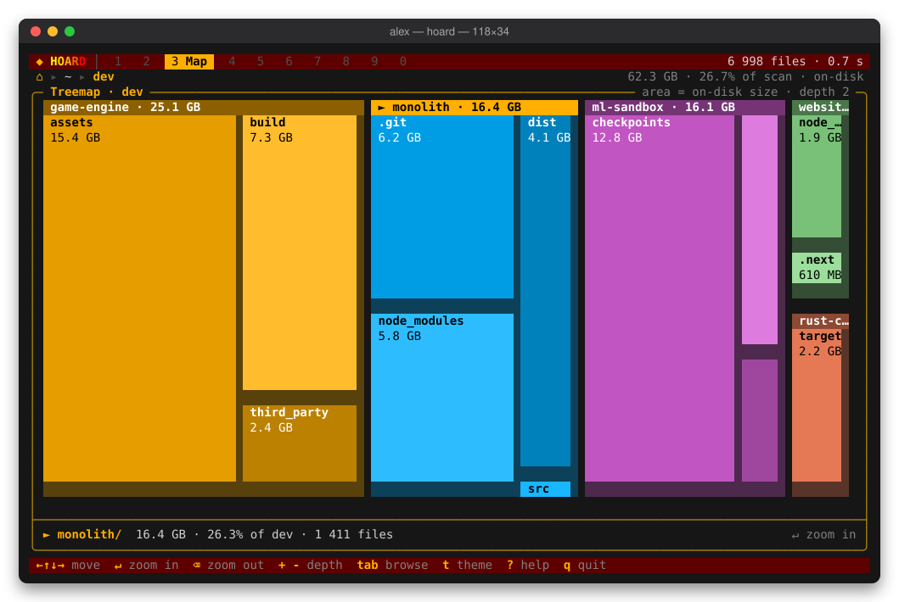
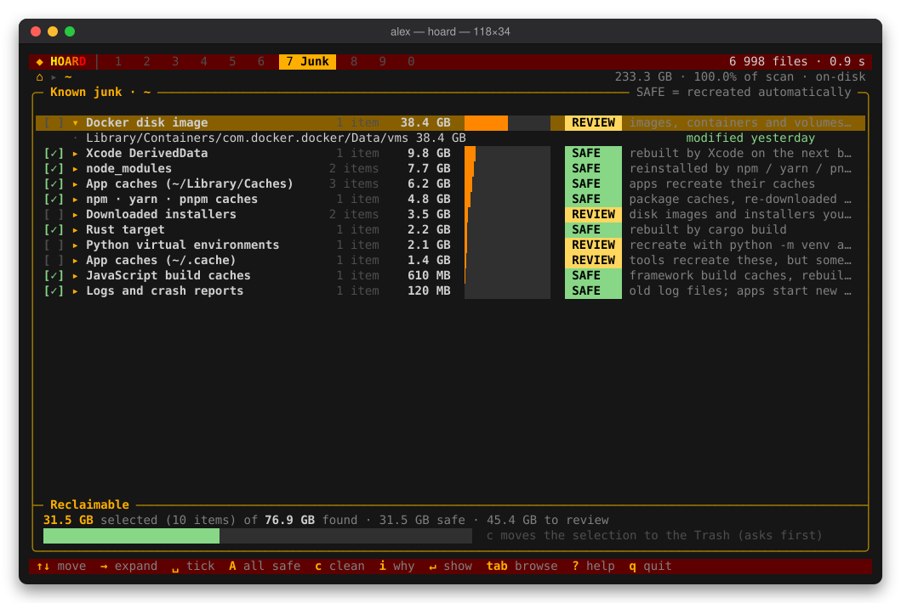
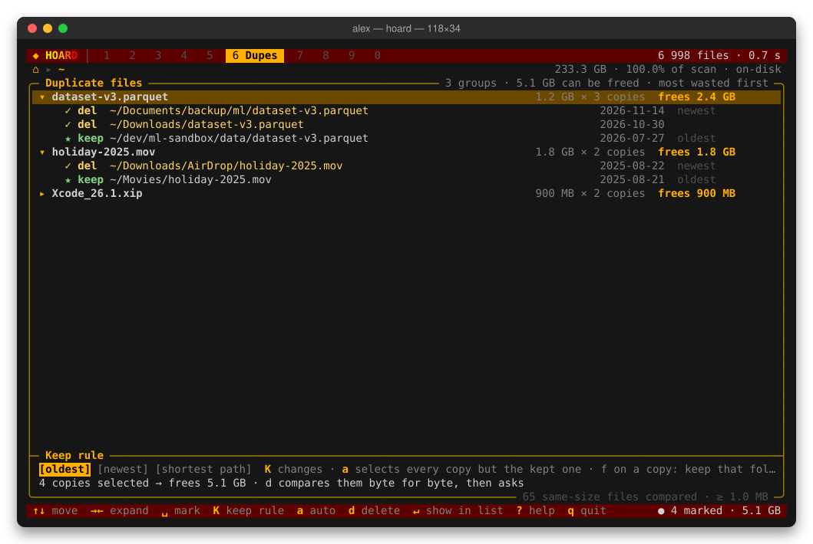
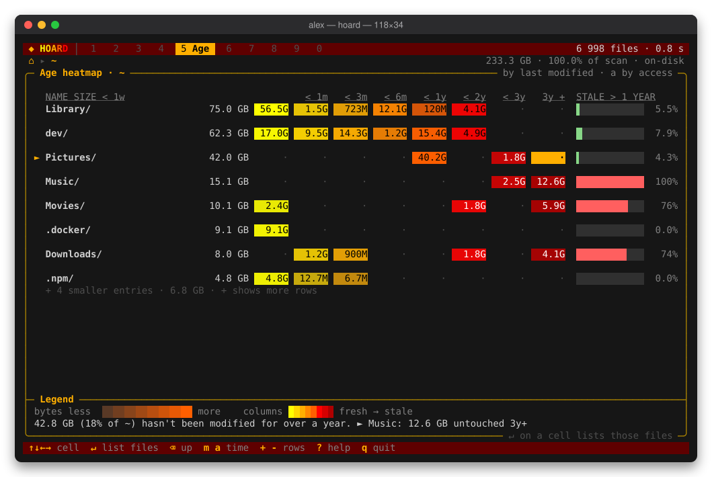
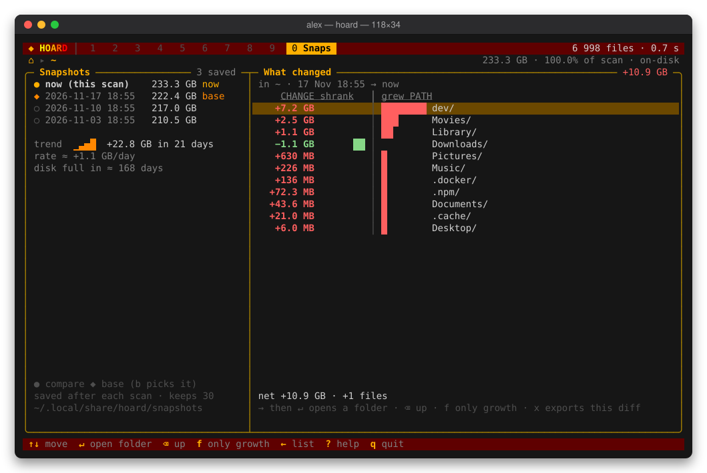

<div align="center">

# ◆ Hoard

**What's hoarding your disk?**

A colourful, very fast disk-space explorer for the terminal.<br>
See where your space went, find what's safe to clear out, and clean up without fear.

[Documentation](https://barpos.github.io/Hoard/) · [Install](#install) · [Quick start](#quick-start) · [Command line](#command-line)

</div>



## Why Hoard

- **Fast.** A parallel scanner reads a whole Mac in seconds (≈ 300 000 entries a second here), and you can look around while it's still counting.
- **Answers, not just numbers.** One screen says how much you could free and where: known junk, big files nobody has touched for years, and duplicates.
- **Safe.** Deleting goes to the Trash, and `u` undoes it. Hoard always asks first, refuses system paths, and leaves installed software alone. Before it deletes a duplicate, it compares the bytes.
- **Pleasant.** Gradients, a treemap, heatmaps and thirteen themes, including two light ones. Mouse support. Every screen adapts to the window size, and nothing ever freezes the UI.
- **Honest about sizes.** It shows the space actually used on disk, counts hard links once, and knows about APFS clones and macOS firmlinks.

## Install

macOS on Apple Silicon:

```bash
curl -fsSL https://github.com/BarPos/Hoard/releases/latest/download/install.sh | bash
```

The installer asks whether to install for you (`~/.local/bin`) or for all users (`/usr/local/bin`). Run it again to update, or use `install.sh uninstall` to remove Hoard. See [Installation](https://barpos.github.io/Hoard/install.html) for every option and for building from source.

## Quick start

```bash
hoard              # explore the current folder
hoard ~            # your home folder
hoard /            # the whole disk
```

Press `?` for every key, or `:` to find any action by name. The essentials:

| Key | Does |
|---|---|
| `1`–`9`, `0`, `tab` | switch tabs: Overview, Browse, Map, Types, Age, Dupes, Junk, Big+Old, Empty, Snaps |
| `↑↓` `→` `←` | move, open a folder, go back up |
| `␣` then `d` | mark things in any tab, then move them all to the Trash (`u` undoes) |
| `/` | find anything in the scan, fuzzy |
| `x` | export a report: HTML that looks like this, JSON, CSV, Markdown, ncdu |
| `,` | settings and themes, saved to `~/.config/hoard/config.toml` |
| `q` | quit (it asks first) |

## A look around

| | |
|---|---|
|  |  |
| **Browse:** biggest first, with size bars, ages and a details pane | **Map:** a squarified treemap; the arrow keys move between blocks |
|  |  |
| **Junk:** build outputs, caches and leftovers, and why each is safe | **Dupes:** identical files; ticks every copy but the one you keep |
|  |  |
| **Age:** how old the bytes in each folder are | **Snaps:** what grew since last time, and when the disk fills up |

There's more in the [tour](https://barpos.github.io/Hoard/tour.html): file types, big & old files, empty folders, watch mode, volumes, find, the command palette and export.

## Command line

Everything also works without the interactive view, for scripts and cron:

```bash
hoard ~ --no-tui -n 20              # the 20 biggest entries
hoard junk ~/dev                    # known junk, by category
hoard old ~ --min-size 500MB        # big files untouched for a year
hoard dupes ~/Downloads             # duplicate files
hoard diff last now --path ~        # what changed since the last snapshot
hoard ~ --export pretty-html -o report.html
hoard check / --fail-above 90%      # exit 3 when the disk is over 90% full
```

All of it is in the [command-line reference](https://barpos.github.io/Hoard/cli.html).

## Building from source

You need the .NET 10 SDK.

```bash
dotnet test Hoard.slnx                                    # run the tests
dotnet run --project src/Hoard.Cli -- ~                   # run it
build/package.sh                                          # the release binary (Native AOT)
dotnet run --project tools/Hoard.Screenshots              # regenerate the screenshots
```

The screenshots in this README and the docs are rendered from the real app by `tools/Hoard.Screenshots`, using a made-up home folder.

Releases are made by hand: bump `VERSION`, push, then run **Actions → Release**. The workflow builds the binary and publishes it with `install.sh`.

## Status

Version 1.0.3. Hoard supports macOS on Apple Silicon. The code is written with Linux and Windows in mind, but they aren't built or tested yet. Third-party licences are listed in [THIRD-PARTY-NOTICES.txt](THIRD-PARTY-NOTICES.txt).
