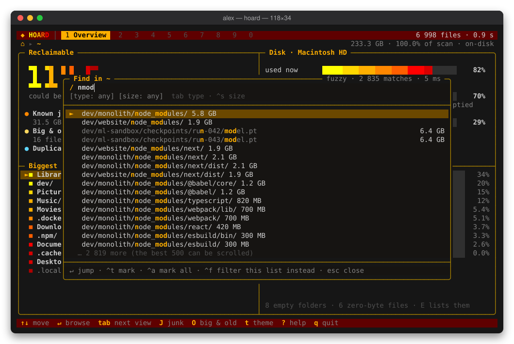
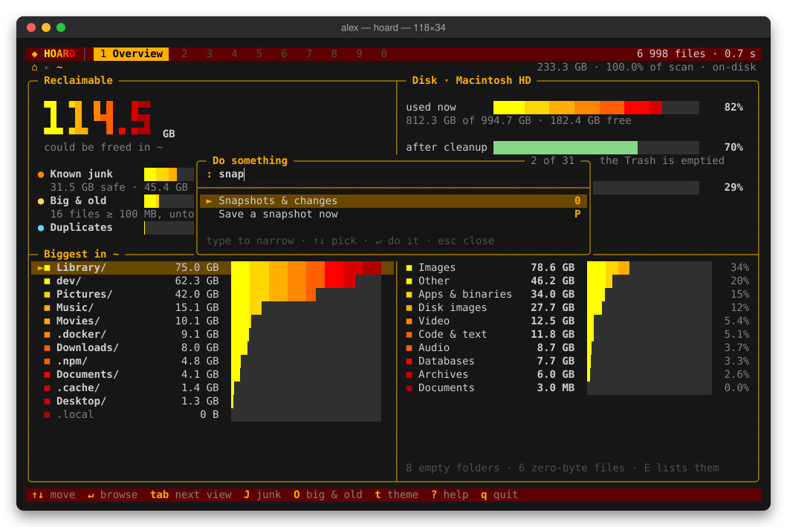
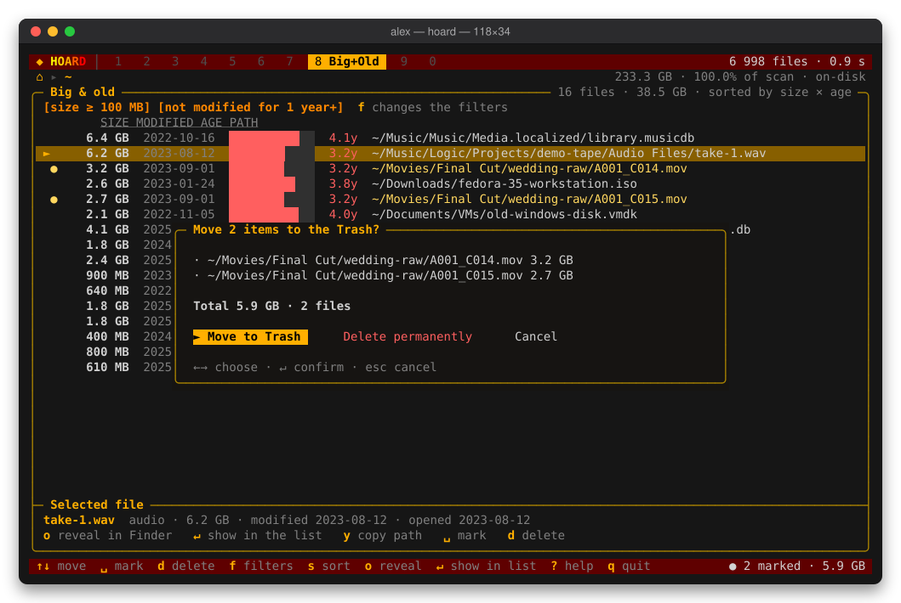
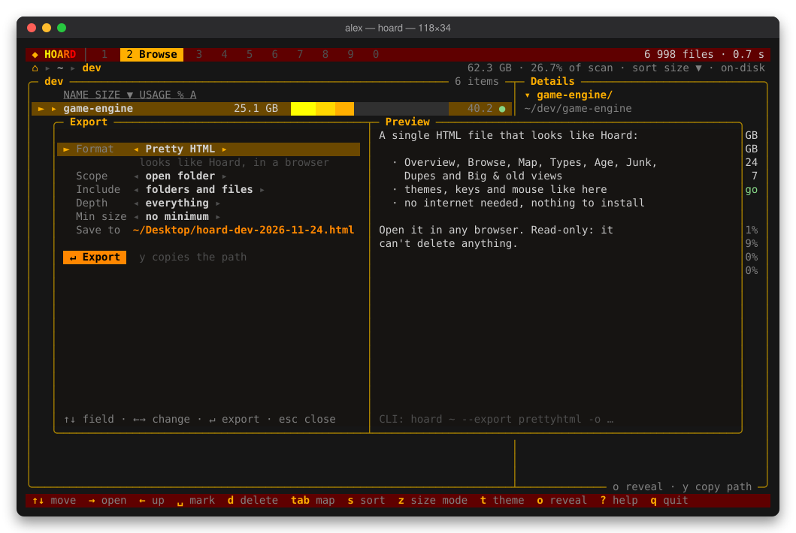

# Doing things

## Find anything

`/` searches the whole scan as you type. Letters only need to appear in order, so `nmod mono` finds `monolith/node_modules`. Matches at the start of a word, letters next to each other, and matches in the name itself rank highest. Matched letters are highlighted.

| Key | Does |
|---|---|
| `↑↓` `↵` | pick a result and jump to it in Browse |
| `tab` | look for anything, folders only, or files only |
| `^s` | only results above a size: 1 MB, 100 MB or 1 GB |
| `^t` / `^a` | mark the highlighted result / mark all results |
| `^f` | filter the open folder's list in place instead (`esc` clears the filter) |
| `esc` | close |

Plain keys are part of the query, so the finder's own actions use `Ctrl`.

## Do anything by name

`:` opens the command palette: every action Hoard has, with its key. Type a few letters (`snap`, `exp`, `old`) and press `↵`. It's also a quick way to learn the keys.

## Marking and deleting

- **Marking:** `␣` marks an entry in any tab, and `A` marks everything shown. Marks are shared between tabs, so you can mark in Browse, Big & old and Dupes, then delete everything at once. The footer always shows how many items are marked and their total size. `u` clears the marks.
- **Deleting:** `d` deletes the marked entries, or the highlighted one if nothing is marked. Hoard always asks first, and lists what will go and how much space it frees.
  - **Move to Trash** is the default. `u` undoes the last move to the Trash and puts everything back.
  - **Delete permanently** needs you to type the item's name, or `delete` for several items. It can't be undone.
- **Never deleted:**
  - the system: `/System`, `/usr`, `/bin` and the other system folders, plus `/`, `/Applications`, `/Library` and `/Users` themselves
  - your home folder itself, and `~/Library`, `~/Documents` and `~/Desktop` themselves (what's inside them can go)
- **Checked first:** everything is checked again just before it's deleted; something that changed in the meantime is skipped and reported. Duplicates are compared byte for byte with the copy you keep, and Hoard never deletes the last copy.

Moving to the Trash doesn't free space until you empty the Trash. The Overview says so where it shows how full the disk would be after cleaning up.

## Rescan

`r` rescans the highlighted folder (or the open one) and replaces its part of the scan; everything else stays as it is. It's quick after you've cleaned something up outside Hoard. `R` rescans everything, keeping your tab and settings.

## Leave things out

There are three ways to keep folders out of the scan:
- **`X`** excludes the highlighted entry right away, so it stops counting, and saves a pattern so future scans skip it too.
- **Settings** (`,`) list the patterns. `del` removes one, and **+ add pattern…** takes one you type.
- **`.hoardignore`** in any folder works like `.gitignore`, for that folder and everything below it.

Patterns are gitignore-style:

| Pattern | Matches |
|---|---|
| `*.tmp` | files ending in `.tmp`, anywhere |
| `build/` | folders called `build`, anywhere (the `/` means folders only) |
| `/vendor` | `vendor` directly in the scanned folder |
| `**/cache/**` | everything inside any `cache` folder |
| `~/Library/Mobile Documents` | that exact folder in your home |
| `//Volumes/Backup/**` | an absolute path (two slashes) |
| `!keep.me` | not excluded, even if an earlier pattern matched |

Excluded entries show as `⊘` in the list. On the command line, `--exclude` (or `-x`) adds patterns for one run.

## Export a report

`x` opens the export dialog, with a preview of the output:

| Format | For |
|---|---|
| **Pretty HTML** | a single file that looks like Hoard in the browser, with the same views, keys and themes. Read-only, works offline. |
| **HTML** | plain HTML with no styles or scripts: folders open and close with `
`. It survives email and archiving, and works with screen readers. |
| **JSON** | the full tree with metadata, for other tools (schema version 1) |
| **CSV** | one row per entry, for spreadsheets |
| **Markdown** | a summary with tables, for tickets and pull requests |
| **ncdu JSON** | ncdu's format, so you can open it with `ncdu -f` |

- **Scope:** the open folder, the whole scan, or only the marked items.
- **Options:** folders only, a depth limit and a minimum size.
- **File:** the dialog suggests a name on your Desktop; `↵` on the path lets you type another.

The report includes every report that's ready, such as junk, big & old, duplicates (if you've looked for them) and empty folders. From a script: `hoard ~ --export pretty-html -o report.html`.

## Quit

`q` asks before quitting, and says whether a scan is still running, marks would be lost, or a delete is in progress. `Ctrl-C` quits at once.
