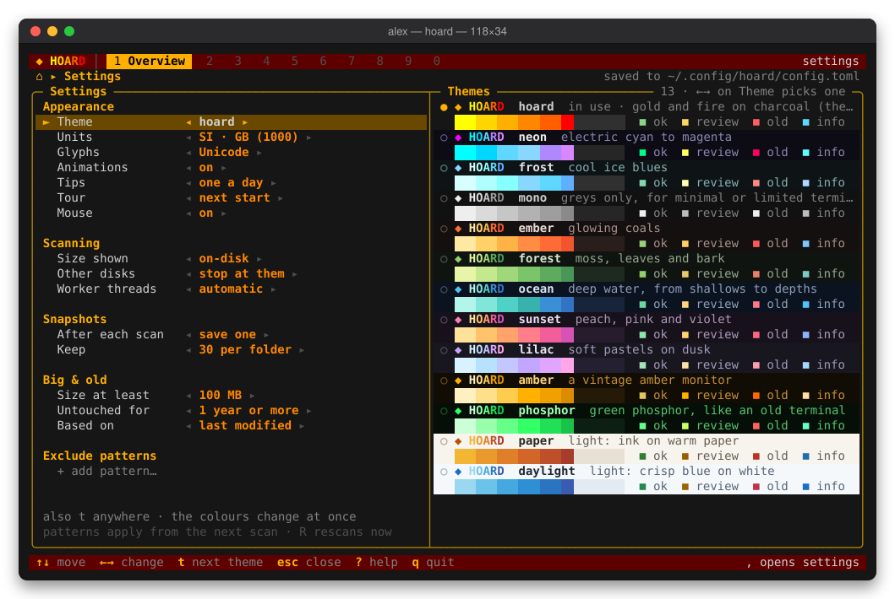
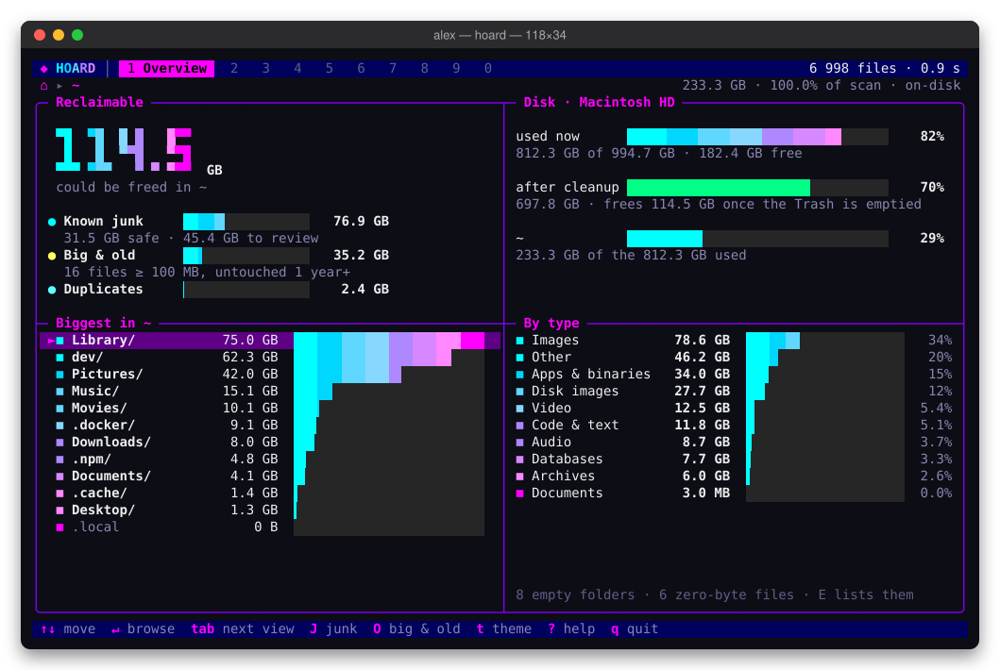
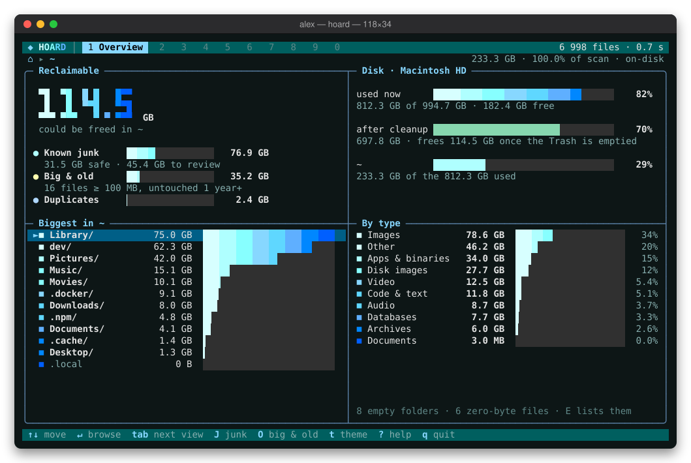
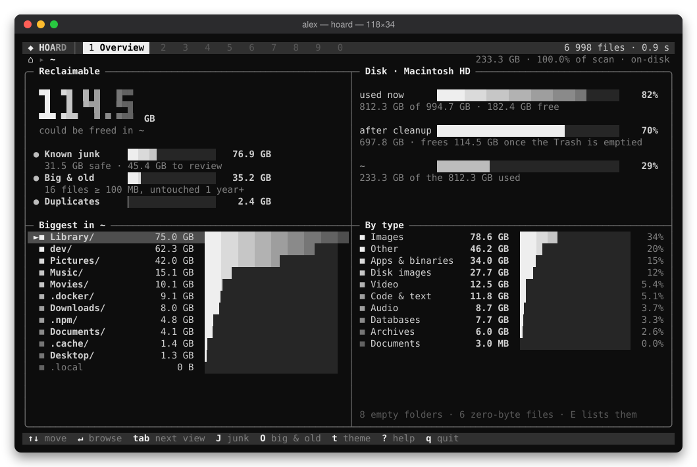
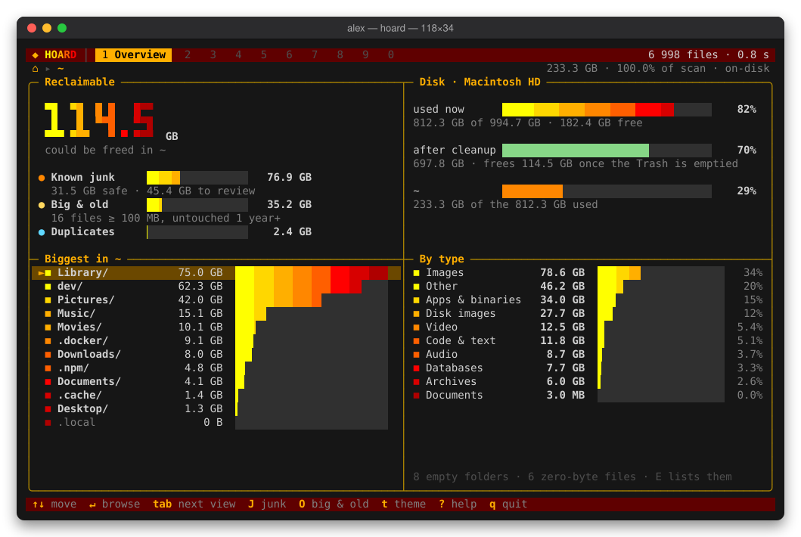

# Settings & files



`,` opens the settings. `↑↓` picks a setting, `←→` changes it, and every change is saved at once. Pressing `t` anywhere also saves the theme.

| Setting | Choices |
|---|---|
| **Theme** | `hoard`, `neon`, `frost`, `mono`. All four are previewed beside the list. |
| **Units** | SI: GB, powers of 1000, matching Finder · IEC: GiB, powers of 1024, like `du -h` |
| **Glyphs** | Unicode, or plain ASCII for terminals and fonts that show boxes instead of lines and bars |
| **Animations** | the splash at start |
| **Tips** | a tip a day on the splash and scanning screens |
| **Tour** | set to "next start" to see the three-step introduction again |
| **Mouse** | on or off, if your terminal's mouse support gets in the way |
| **Size shown** | on-disk (space actually used) or apparent (file lengths) |
| **Other disks** | stop at disks mounted inside the scanned folder, or scan into them |
| **Worker threads** | automatic, or 1–16 |
| **Snapshots** | save one after each scan or not; how many to keep per folder |
| **Big & old** | the default minimum size, minimum age, and modified or opened |
| **Exclude patterns** | see [Leave things out](actions.html#leave-things-out) |

The theme gallery:

| | |
|---|---|
|  |  |
|  |  |

## The settings file

Settings live in `~/.config/hoard/config.toml`, or `$XDG_CONFIG_HOME/hoard/config.toml` if that's set. You can edit it by hand: if a line is wrong, Hoard says so when it starts and loads the rest.

```toml
theme = "hoard"            # hoard, neon, frost or mono
mouse = true
units = "si"               # si: GB (1000) · iec: GiB (1024)
animations = true
tips = true
tour_done = false
glyphs = "unicode"         # ascii for terminals or fonts without box drawing
apparent_sizes = false
cross_filesystems = false
threads = 0                # 0 = automatic
exclude = ["**/.git/objects", "~/Library/Mobile Documents"]
auto_snapshot = true
keep_snapshots = 30

[big_old]
min_size = 100000000
min_age_days = 365
based_on = "modified"      # or "accessed"
```

Options on the command line, like `--theme` or `--exclude`, override the file for that run.

## Where Hoard keeps things

| What | Where |
|---|---|
| settings | `~/.config/hoard/config.toml` (`$XDG_CONFIG_HOME`) |
| snapshots | `~/.local/share/hoard/snapshots/` (`$XDG_DATA_HOME`) |
| duplicate hash cache | `~/.cache/hoard/hashes.tsv` (`$XDG_CACHE_HOME`) |
| the program | `~/.local/bin/hoard` or `/usr/local/bin/hoard` |

`install.sh uninstall --purge` removes all of them. Hoard never sends anything over the network.

## Environment variables

| Variable | Does |
|---|---|
| `HOARD_ANIMATE=0` | no splash (`1` shows it even if it's off in settings) |
| `NO_COLOR` | no colours in command-line output |
| `XDG_CONFIG_HOME`, `XDG_DATA_HOME`, `XDG_CACHE_HOME` | move the settings, snapshots and cache |
| `HOARD_USER_DIR`, `HOARD_SYSTEM_DIR` | where `install.sh` puts the program |
