<div class="hero">
  <h1><span class="grad">◆ HOARD</span></h1>
  <p class="tag">What's hoarding your disk?</p>
  <p class="sub">A colourful, very fast disk-space explorer for the terminal. See where your space went, find what's safe to clear out, and clean up without fear.</p>
</div>

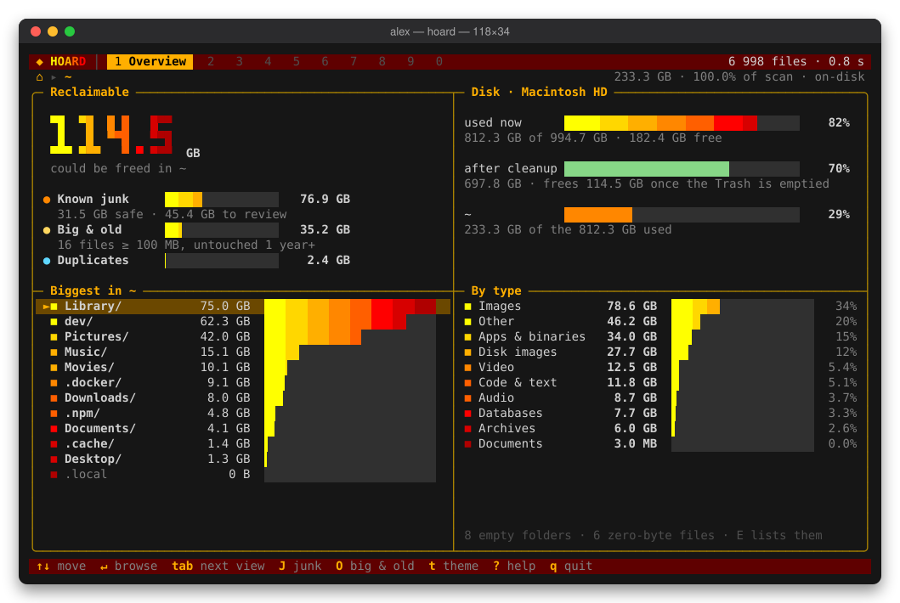

```bash
curl -fsSL https://github.com/BarPos/Hoard/releases/latest/download/install.sh | bash
hoard ~
```

macOS on Apple Silicon. [More install options →](install.html)

## What it does

<div class="grid">
<div class="card" markdown="1">

### Scans fast, shows results at once
A parallel scanner reads a whole Mac in seconds, about 300 000 entries a second. Folders fill in while you look around. [The scanning screen →](tour.html#scanning)

</div>
<div class="card" markdown="1">

### Says what you could free
The Overview adds up known junk, big files nobody has touched for a year, and duplicates. It counts each file once, and shows how full the disk would be afterwards. [Overview →](tour.html#overview)

</div>
<div class="card" markdown="1">

### Knows what's safe
Junk comes with a reason and a <span class="badge safe">SAFE</span> or <span class="badge review">REVIEW</span> badge. Installed software, app bundles and git's own files are left alone. [Junk →](tour.html#junk)

</div>
<div class="card" markdown="1">

### Cleans up without fear
Mark things anywhere and delete them together. They go to the Trash, and `u` undoes it. Hoard refuses system paths, and checks duplicates byte for byte first. [Deleting →](actions.html#marking-and-deleting)

</div>
<div class="card" markdown="1">

### Remembers
A snapshot after every scan shows what grew since last time, how fast, and when the disk will be full. [Snapshots →](tour.html#snapshots)

</div>
<div class="card" markdown="1">

### Fits in
It works from scripts too: reports and checks on the command line, and exports to JSON, CSV, HTML, Markdown and ncdu. [Command line →](cli.html)

</div>
</div>

## Ten views of the same scan

| | |
|---|---|
| [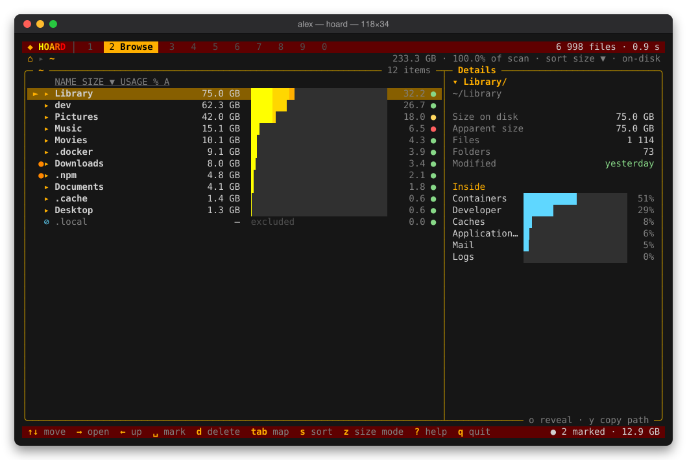](tour.html#browse) | [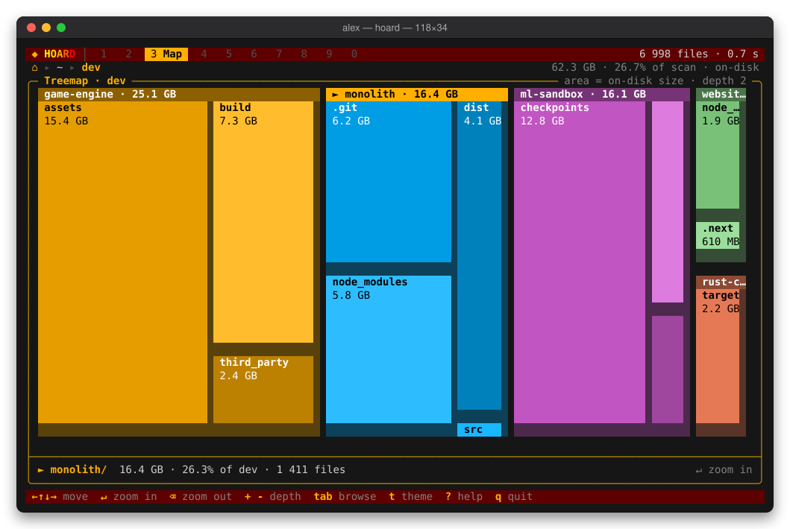](tour.html#map) |
| **Browse:** the folder list, biggest first | **Map:** a treemap, where area is size |
| [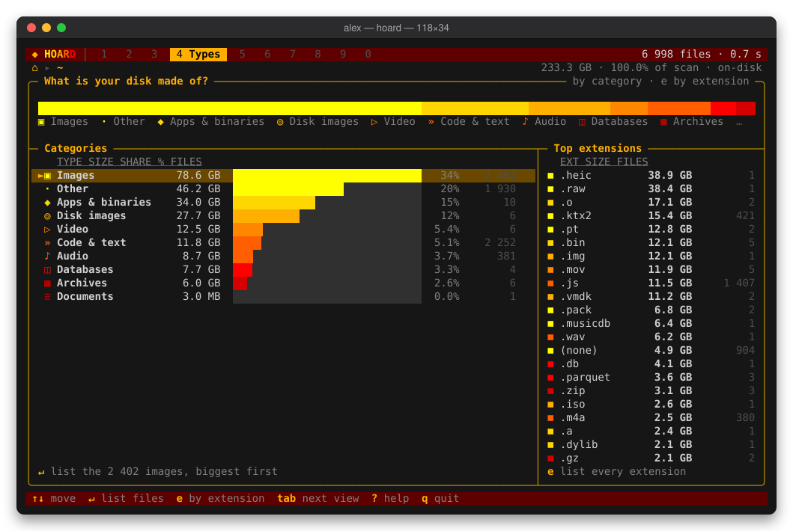](tour.html#types) | [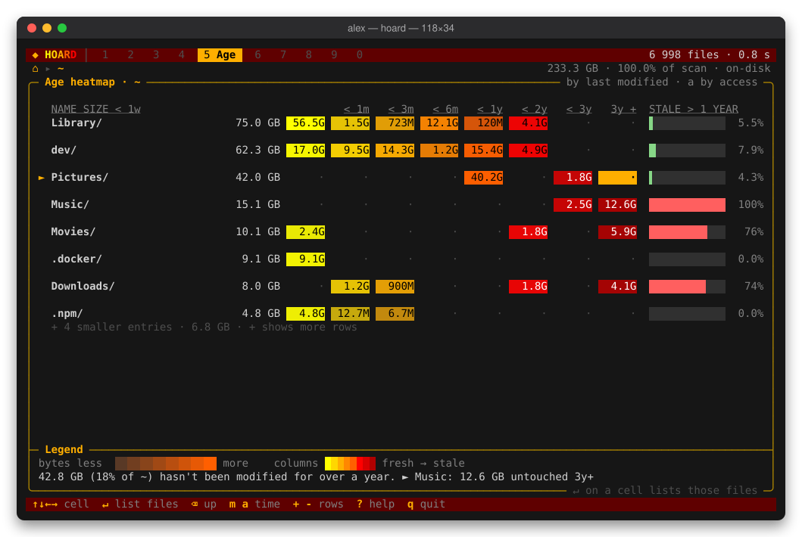](tour.html#age) |
| **Types:** video, images, code, apps… | **Age:** how old the bytes are, folder by folder |
| [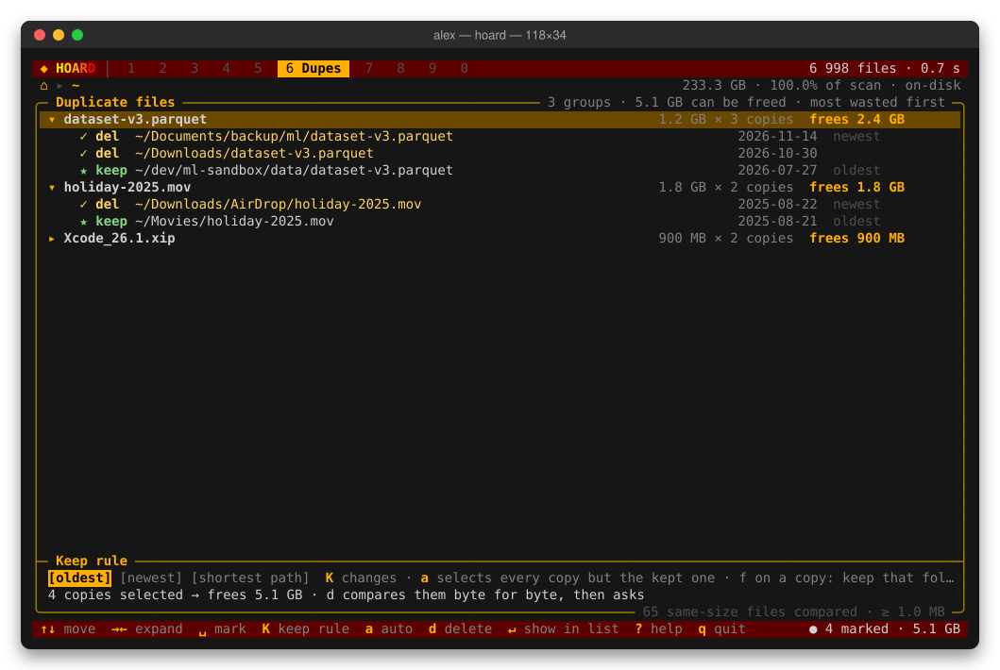](tour.html#duplicates) | [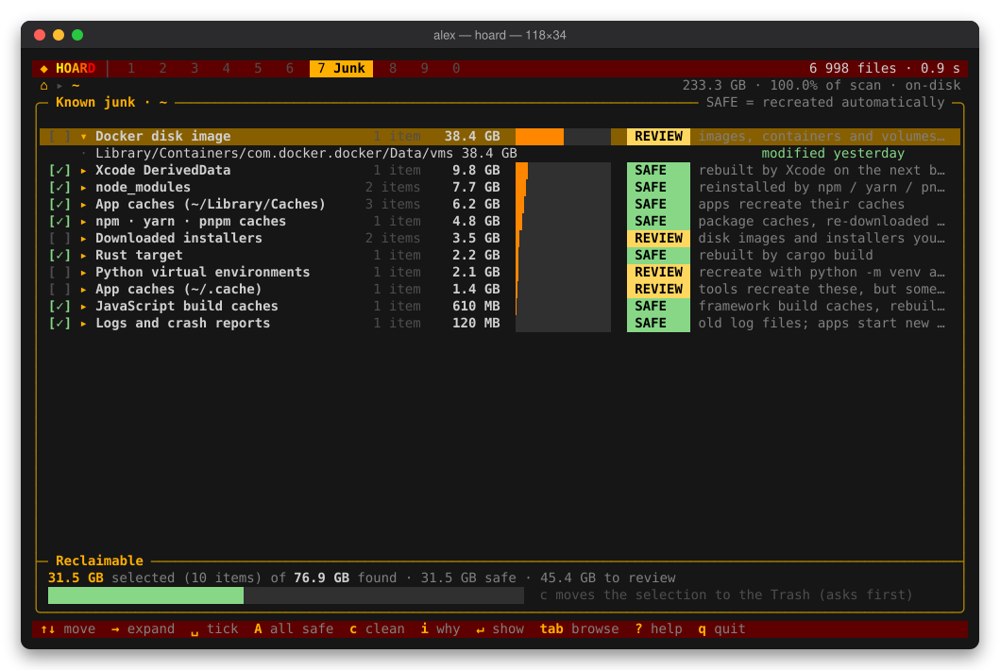](tour.html#junk) |
| **Dupes:** identical files, APFS clones recognised | **Junk:** caches, build outputs, leftovers |
| [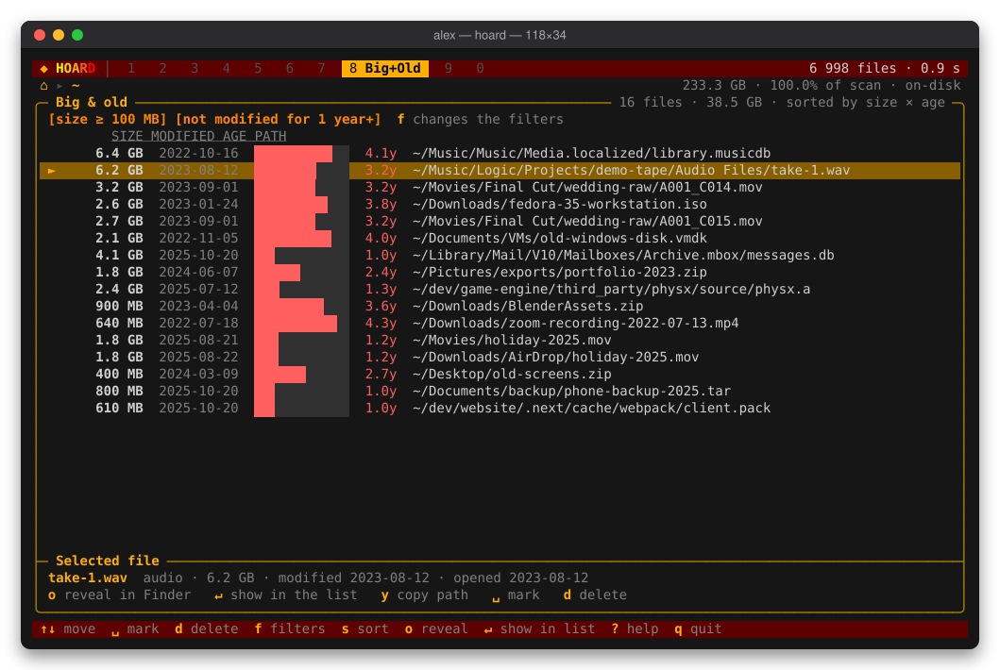](tour.html#big--old) | [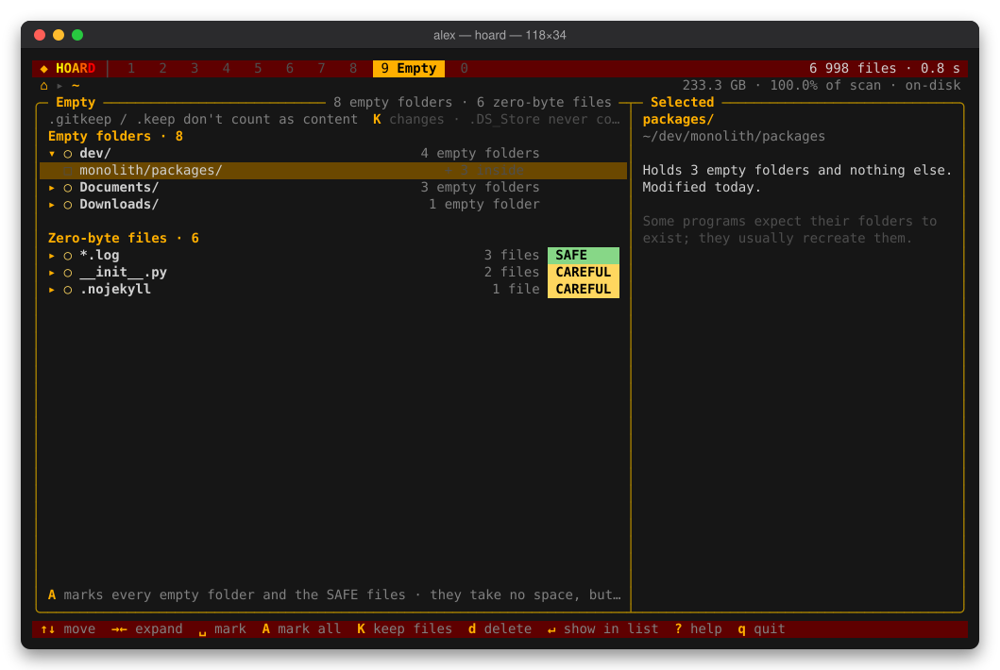](tour.html#empty) |
| **Big & old:** large files nobody has touched | **Empty:** empty folders and zero-byte files |
| [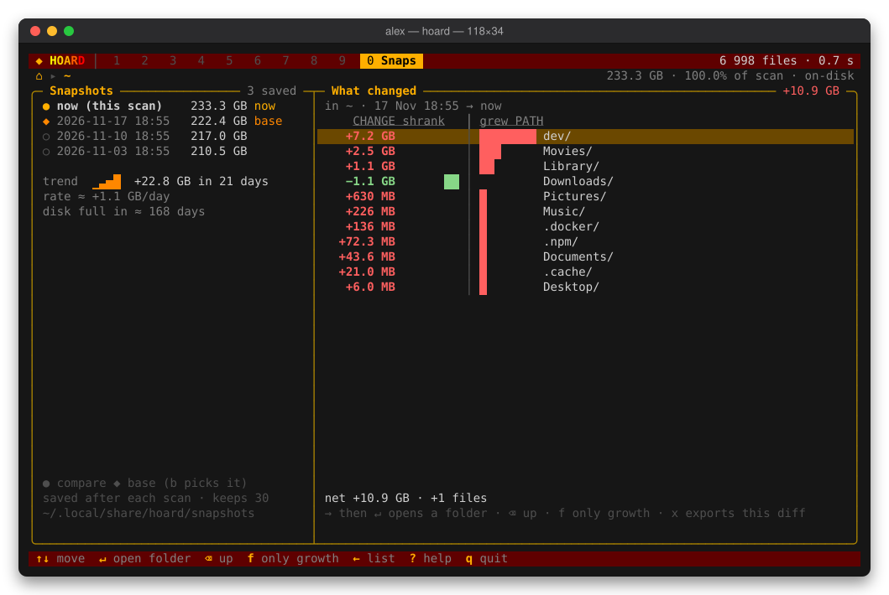](tour.html#snapshots) | [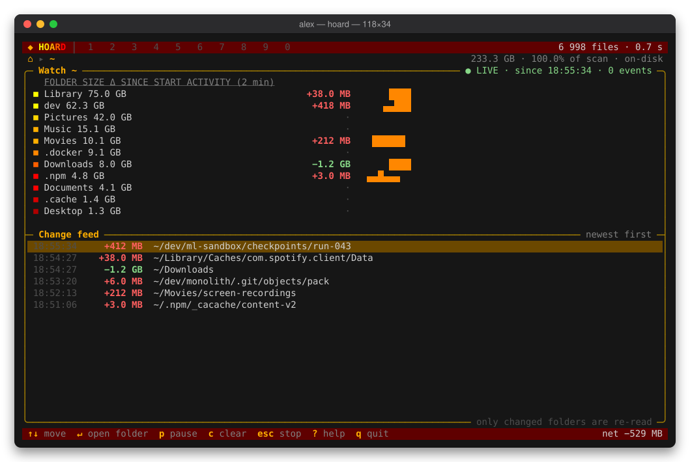](tour.html#watch) |
| **Snaps:** what changed since last time | **Watch:** sizes that update as files change |

## Made to be easy

- **Discoverable.** The footer always lists the keys that matter in the current view. `?` shows every key, and `:` finds any action by name.
- **Never stuck.** Every analysis runs in the background with a progress bar, so the screen never freezes. `esc` always backs out one level.
- **Forgiving.** Deleting goes to the Trash, `u` undoes it, and nothing destructive is a single key press.
- **Yours.** Pick from four themes, SI or 1024-based units, and a plain-ASCII mode for limited terminals. It's mouse friendly too. Settings are saved in `~/.config/hoard/config.toml`.

Next: [install it](install.html), then take the [tour](tour.html).
