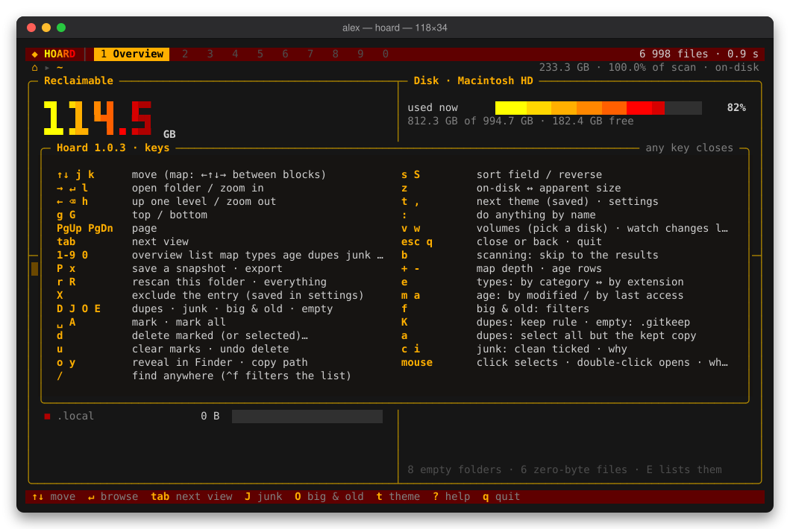

# Keys

`?` shows this inside Hoard, and `:` finds any action by name. A key means the same thing in every view. Text fields (find, paths, patterns) take plain keys as text, so their actions use `Ctrl`.

## Moving around

| Key | Does |
|---|---|
| `↑` `↓` · `j` `k` | move (in the map: `←↑↓→` move between blocks) |
| `→` `↵` · `l` | open a folder, zoom in, expand, or pick |
| `←` `⌫` · `h` | go up a level, zoom out, or collapse |
| `g` `G` | top · bottom |
| `PgUp` `PgDn` | a page up or down |
| `esc` | close, or back out one level |

## Views

| Key | View |
|---|---|
| `1` | Overview |
| `2` | Browse |
| `3` | Map |
| `4` | Types |
| `5` | Age |
| `6` · `D` | Duplicates |
| `7` · `J` | Junk |
| `8` · `O` | Big & old |
| `9` · `E` | Empty |
| `0` | Snapshots |
| `tab` | the next view |
| `v` | volumes: pick a disk or folder to scan |
| `w` | watch changes live |

## Doing things

| Key | Does |
|---|---|
| `␣` | mark / unmark |
| `A` | mark everything shown |
| `d` | delete the marked entries (or the highlighted one); asks first |
| `u` | clear the marks, or undo the last move to the Trash |
| `o` | show in Finder |
| `y` | copy the path |
| `/` | find anything |
| `:` | the command palette |
| `x` | export a report |
| `P` | save a snapshot now |
| `r` · `R` | rescan this folder · everything |
| `X` | exclude the entry from scans |
| `s` · `S` | sort by the next field · reverse the sort |
| `z` | on-disk ↔ apparent sizes |
| `t` | next theme (saved) |
| `,` | settings |
| `?` | help |
| `q` | quit (asks first) · `Ctrl-C` quits at once |

## In particular views

| View | Key | Does |
|---|---|---|
| Map | `+` `-` | draw more or fewer levels |
| Types | `e` | categories ↔ extensions |
| Age | `m` · `a` | by last modified · by last opened |
| Age | `+` `-` | more or fewer rows |
| Dupes | `K` | keep rule: oldest, newest, shortest path, or a folder |
| Dupes | `a` | tick every copy except the kept one |
| Dupes | `f` | keep the copies in this copy's folder |
| Junk | `c` · `i` | clean the ticked ones · why it counts |
| Big & old | `f` | filters |
| Empty | `K` | `.gitkeep` / `.keep` count as content, or not |
| Snapshots | `b` | set the base snapshot |
| Snapshots | `f` | only growth |
| Snapshots | `del` (twice) | delete a snapshot |
| Watch | `p` · `c` | pause · clear the feed |
| Volumes | `~` · `p` · `H` | home folder · type a path · show system volumes |
| Scanning | `b` `↵` | see the results now |
| Find | `tab` · `^s` | type filter · size filter |
| Find | `^t` · `^a` · `^f` | mark · mark all · filter the open list instead |

## Mouse

Click to select, double-click to open, and use the wheel to scroll (in the map it zooms). Click a tab to switch views, and a breadcrumb to jump to that folder. The row under the pointer is highlighted. If your terminal's mouse support gets in the way, switch it off in settings.
