# Tour

Hoard has ten views of the same scan. Number keys jump straight to one, and `tab` goes to the next:

| Key | View | Shows |
|---|---|---|
| `1` | [Overview](#overview) | what you could free, the disk, the biggest entries and file types |
| `2` | [Browse](#browse) | the folder list, biggest first |
| `3` | [Map](#map) | a treemap, where area is size |
| `4` | [Types](#types) | what the space is made of |
| `5` | [Age](#age) | how old the bytes are, folder by folder |
| `6` or `D` | [Dupes](#duplicates) | files with identical contents |
| `7` or `J` | [Junk](#junk) | known junk, with a reason for each |
| `8` or `O` | [Big & old](#big--old) | large files nobody has touched for a long time |
| `9` or `E` | [Empty](#empty) | empty folders and zero-byte files |
| `0` | [Snaps](#snapshots) | what changed since earlier scans |

Two more screens: `w` [watches](#watch) for changes, and `v` lists your [volumes](#volumes).

## Starting up

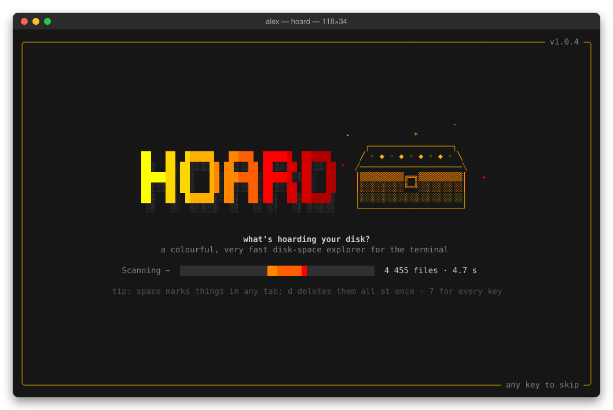

The splash shows for about a second and a half while the scan starts; any key skips it. You can switch it off with the **Animations** setting, `--no-animate` or `HOARD_ANIMATE=0`.

### Scanning

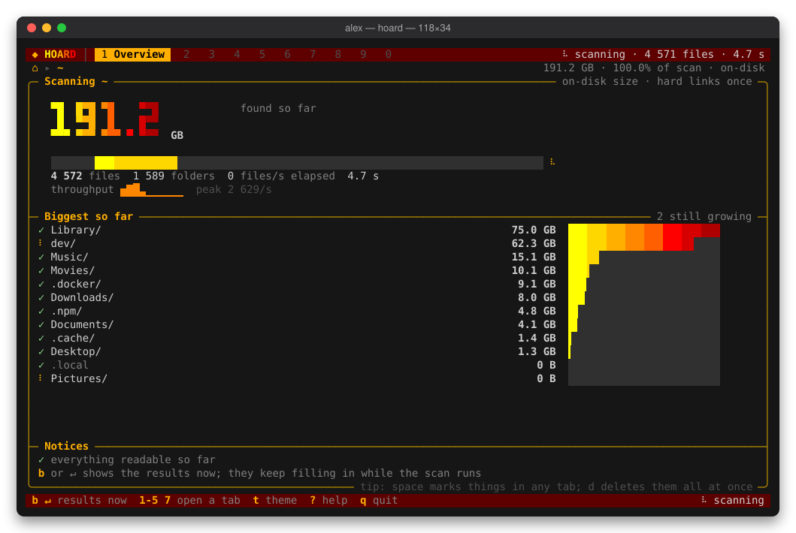

While the scan runs you see:
- what's been found so far
- a progress bar: a real percentage when you scan a whole disk, otherwise a moving bar
- files and folders counted, files per second, and a throughput graph
- the biggest folders so far, each with a spinner while it's still growing

Press `b` or `↵` to go to the results right away. They keep filling in as the scan continues, and a number key jumps straight to that tab.

The first time you run Hoard, a short three-step tour points at the size bars, the Junk tab, and marking and deleting.

## Overview

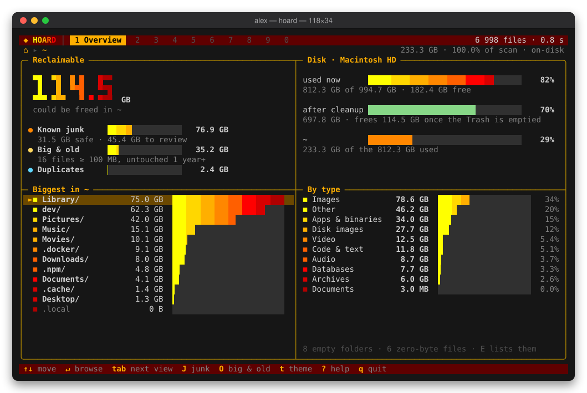

The start screen answers "where did my space go, and what can I do about it?"

- **Reclaimable:** known junk, big & old files and duplicates. A file that falls under more than one counts only once. Duplicates are only included after you've opened the Dupes tab, because finding them means reading files.
- **Disk:** how full the disk is now, how full it would be after cleaning up, and how much of it this scan accounts for. It also shows hard links (counted once) and APFS clones.
- **Biggest:** the largest entries of the scanned folder. `↵` opens one in Browse.
- **By type:** the categories, plus how many empty folders and zero-byte files there are.

## Browse

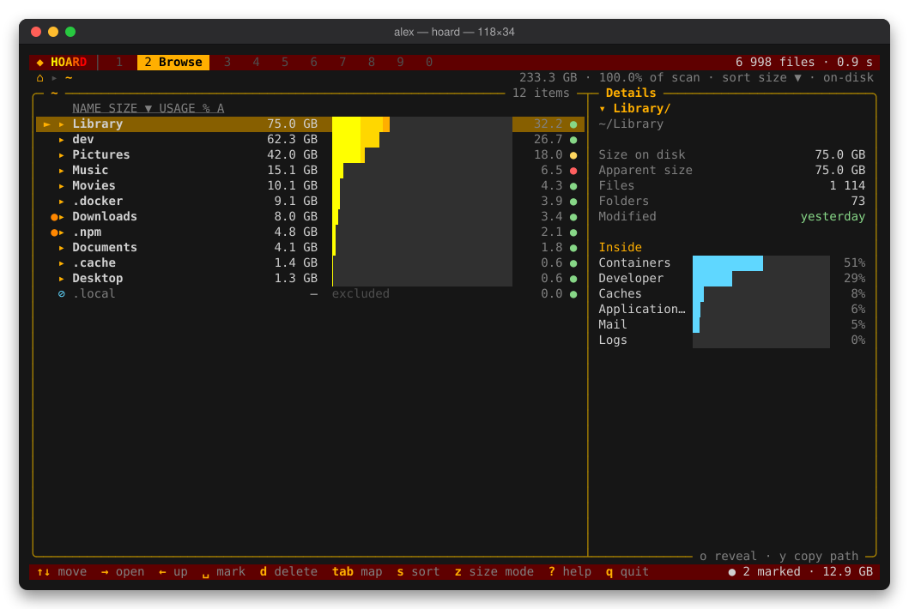

The folder list, with a size bar, a share of the parent folder, and an age dot for each entry. The dot is green for changed recently, yellow for months ago, and red for over a year. From 100 columns wide, a details pane shows the selected entry's sizes, counts, dates and its biggest contents.

- `→` or `↵` opens a folder, `←` or `⌫` goes up, and clicking the breadcrumbs jumps there.
- `s` changes the sort (size, name, files, modified) and `S` reverses it.
- `z` switches between on-disk and apparent sizes.
- `␣` marks an entry, `A` marks everything shown, and `d` deletes what's marked. See [marking and deleting](actions.html#marking-and-deleting).
- `o` shows the entry in Finder, and `y` copies its path.

## Map

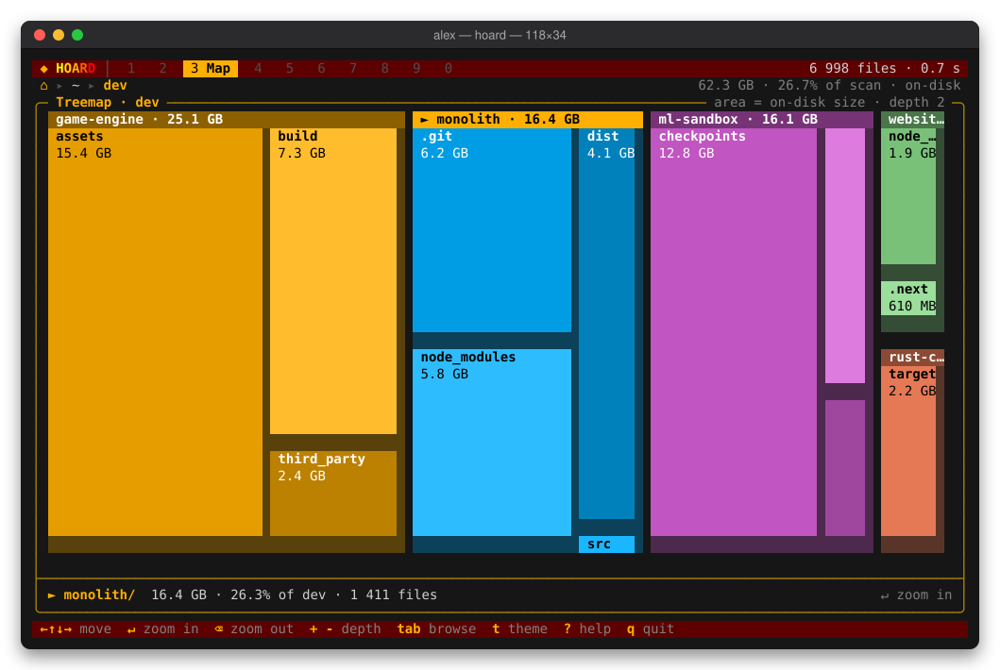

A squarified treemap: every block's area is its size. The arrow keys move between neighbouring blocks, `↵` zooms in, `⌫` zooms out, and `+` and `-` change how many levels are drawn. Very small entries are grouped into one block so they stay readable. You can click to select and double-click to open.

## Types

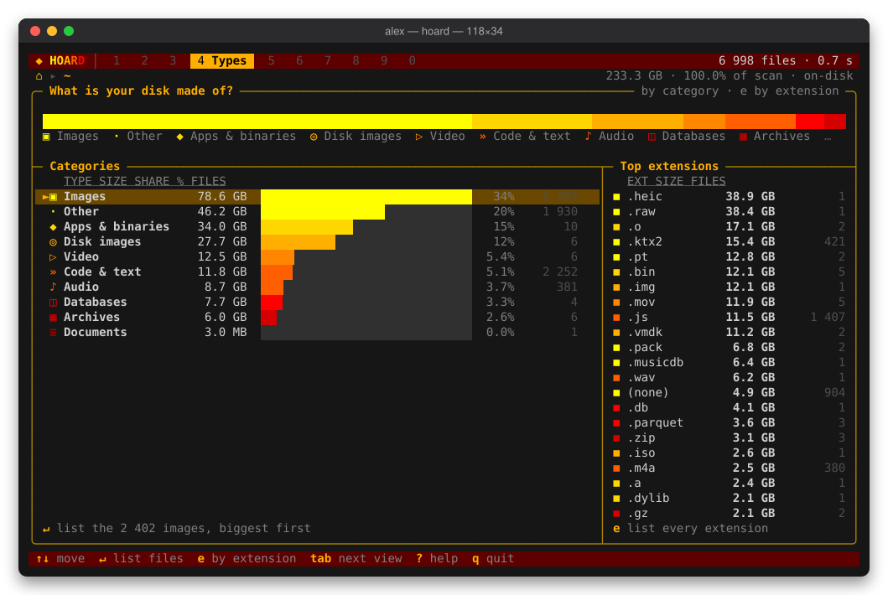

What the space is made of: video, images, audio, archives, disk images, documents, fonts, code and text, apps and binaries, databases, and other. Hoard decides by extension, and is a bit cleverer than that:
- `libssl.so.3` counts as `.so`, not `.3`
- programs without an extension in `bin/` folders count as apps
- everything inside an `.app` bundle counts as an app

`e` switches between categories and individual extensions. `↵` lists the biggest files of a category or extension. You can mark, delete, show them in Finder, or jump to them in Browse.

## Age

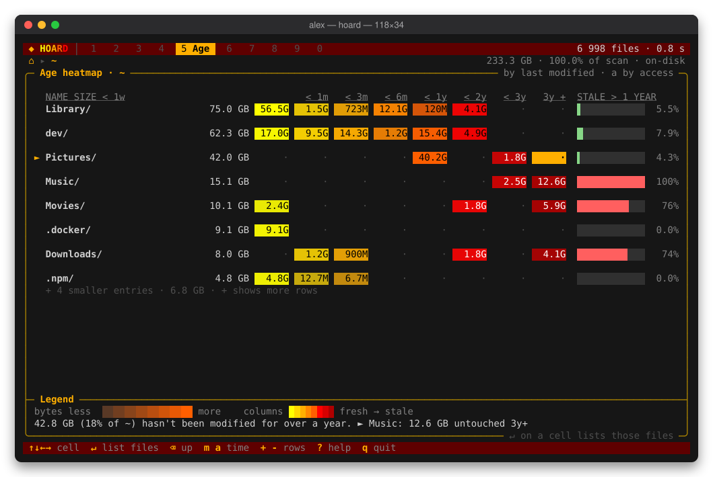

Each row is one of the biggest entries in the open folder, and each column is an age group, from under a week to three years and more. The brighter the cell, the more bytes it holds. The last column is the share untouched for over a year.

- The arrow keys move between cells. `↵` on a cell lists its files, and `↵` on a name opens that folder.
- `m` and `a` switch between last modified and last opened. macOS updates "last opened" loosely, so treat it as a rough guide.
- `+` and `-` show more or fewer rows.

## Duplicates

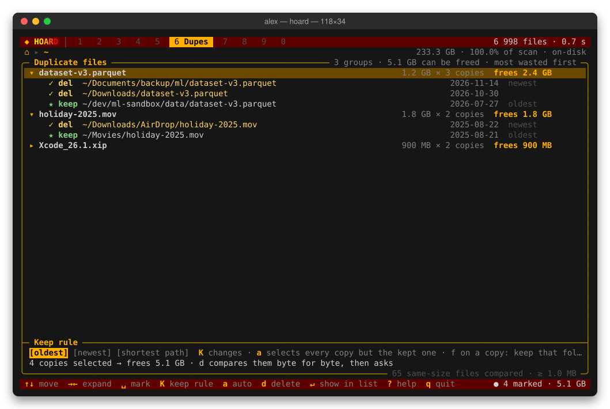

Files with exactly the same contents, found in three steps:
1. same size
2. same first 64 KB
3. same full XxHash128

Most files are never read in full. The search starts when you open the tab, runs in the background with progress, and remembers hashes so the next search is quicker. Hard links aren't duplicates: they're one file under two names.

APFS clones are recognised. Copies made with Finder's Duplicate or `cp -c` share disk space, so deleting one frees almost nothing; Hoard asks macOS how much each copy really owns, and says "⧉ APFS clones".

- `K` changes which copy to keep: the oldest, the newest, or the one with the shortest path. `f` on a copy keeps the copies in that folder instead.
- `a` ticks every copy except the kept one, in every group. `␣` on a group does the same for that group.
- `d` compares each ticked copy with the kept one byte for byte, then asks before deleting.
- You can never tick, or delete, the last copy of a file.

Duplicates inside installed software, app bundles and `.git` are left out: removing one would break whatever it belongs to.

## Junk

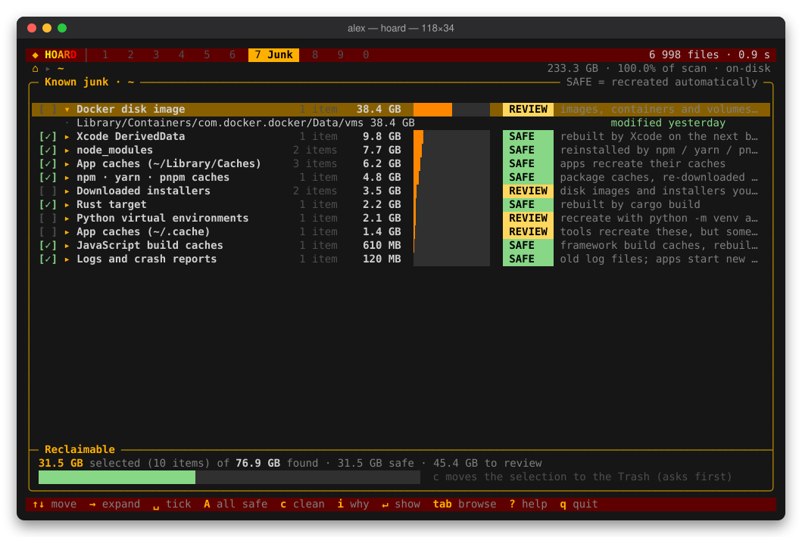

Things that are rebuilt or downloaded again automatically. Each rule says why it's junk:
- **Build outputs:** Xcode DerivedData, archives and device support; `node_modules`; JavaScript build caches; .NET `bin`/`obj`; Rust and Maven `target`; Gradle, Swift and CMake builds; Dart/Flutter tools; Terraform plugins.
- **Python:** caches and virtual environments.
- **Package caches:** npm, yarn, pnpm, Cargo, Gradle, NuGet, Maven and Go module caches.
- **Other:** app caches in `~/Library/Caches` and `~/.cache`, logs and crash reports, the Docker disk image, the Trash, and installers you've downloaded.

SAFE categories are ticked to begin with: they come back by themselves. REVIEW ones need a look first.

Project folders only count when the project file is there: `node_modules` needs a `package.json`, and `target` needs a `Cargo.toml` or `pom.xml`. Folders inside installed software (Homebrew's `Cellar`, `site-packages`…) never count.

- `␣` ticks a category or a single item, `A` ticks every SAFE category, and `→` lists the items.
- `i` says why something counts, `c` cleans what's ticked, and `↵` on an item shows it in Browse.

## Big & old

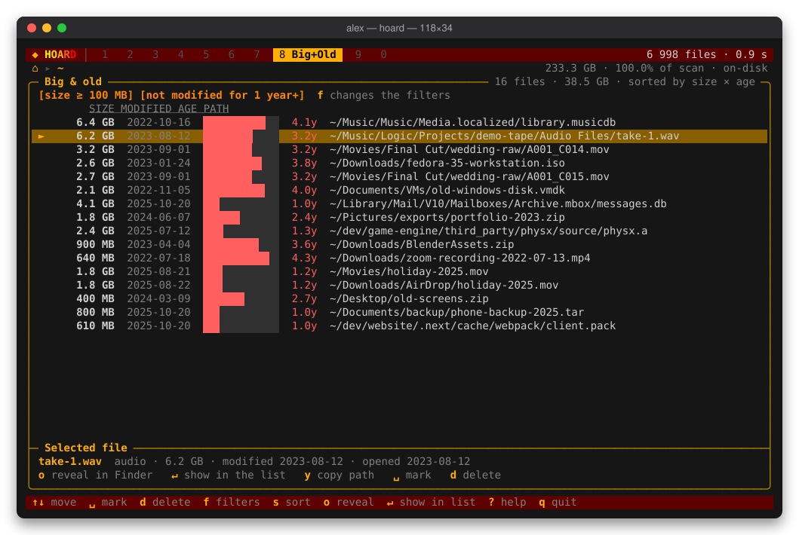

Large files nobody has touched for a long time. By default that's 100 MB or more, not modified for a year. They're sorted so the bigger and older ones come first, and `s` sorts by size, age or path instead.

`f` opens the filters: minimum size (10 MB to 5 GB), minimum age (a month to three years), and whether "touched" means modified or opened. They're remembered for next time.

The strip at the bottom describes the highlighted file. `␣` marks, `d` deletes, `o` shows it in Finder, and `↵` finds it in Browse. As with Dupes and Empty, installed software, app bundles and `.git` aren't listed.

## Empty

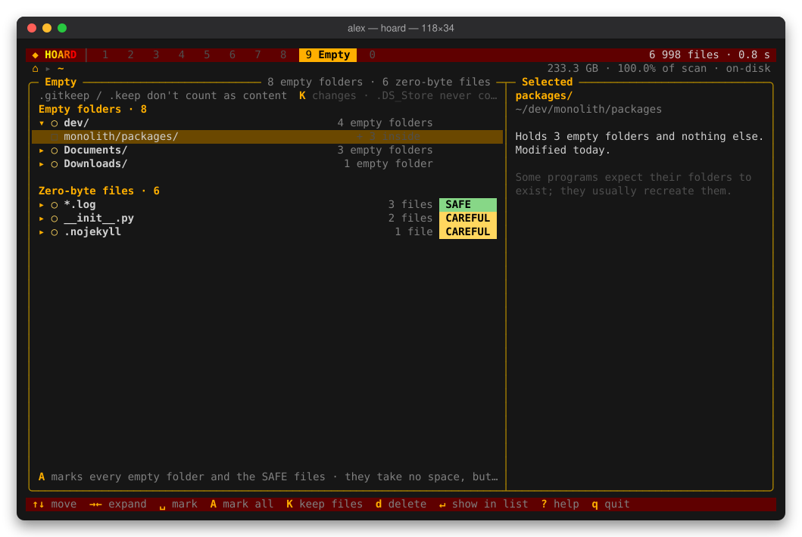

**Empty folders** are grouped by the top-level folder they're in. A folder counts as empty when it holds nothing, only other empty folders, or only `.DS_Store`. `.gitkeep` and `.keep` files don't count as content unless you press `K`. Only the outermost empty folder is listed, with "+ N inside".

**Zero-byte files** are grouped by name pattern, and each group gets a badge:
- SAFE: logs and temporary files
- CAREFUL: Python package markers, `.gitkeep`, lock files
- KEEP: files macOS uses, like folder icons; these can't be marked

`A` marks every empty folder and the SAFE files.

## Snapshots

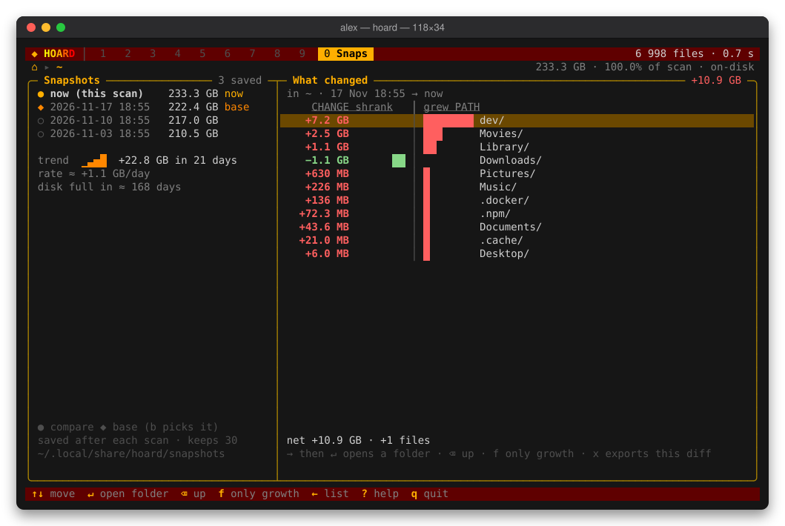

Hoard saves a small snapshot after every finished scan: folder totals only, never individual files. That lets it show what changed:

- **The list:** "now" (this scan) and the saved snapshots. ● marks the one being compared; ◆ marks the base, which `b` sets.
- **Trend:** a graph across all snapshots, the growth per day, and how long until the disk is full at that rate.
- **What changed:** the open folder's entries, by how much they grew (red) or shrank (green), marked new or gone. `→` moves into this list, `↵` opens a folder, `⌫` goes up, and `f` shows only growth.

`P` saves a snapshot now, and `del` twice deletes the highlighted one. The last 30 are kept; the **Snapshots** settings change that. From a script: `hoard snapshot` and `hoard diff`. See [Command line](cli.html).

## Watch

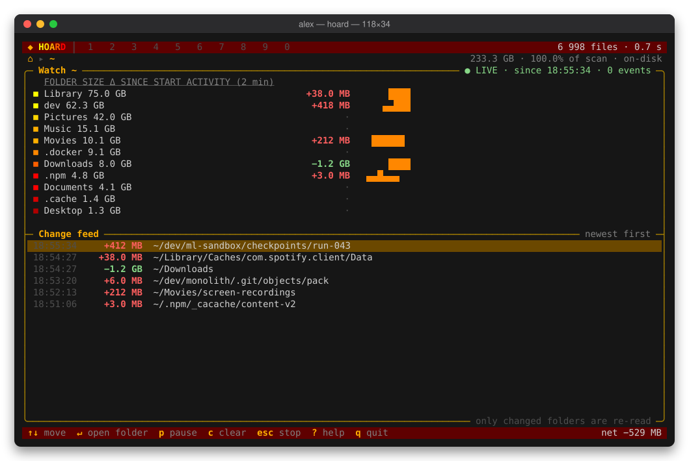

`w` watches the scanned folder. When files change, Hoard reads only the folders that changed, never the whole disk, and updates sizes everywhere. The screen shows each top-level folder's change since you started watching, with a two-minute activity graph, and a feed of changes, newest first.

`↵` opens a changed folder in Browse; watching keeps going, and `w` returns. `p` pauses, `c` clears the feed, and `esc` stops. `hoard watch --log` prints the same changes as JSON lines.

## Volumes

`v` lists your mounted disks, fullest first: name, format, how full, and free space. System volumes that share the startup disk's space are hidden; `H` shows them. `↵` scans a disk, `~` scans your home folder, and `p` takes a path you type.
